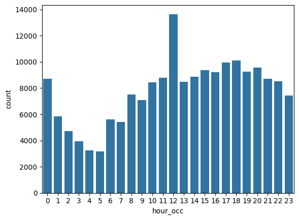

# Analyzing Crime Patterns in Los Angeles


## Overview

Los Angeles is known for its warm weather, palm trees, sprawling coastline, and Hollywood. But as with any highly populated city, there is also a large volume of crime.

This project is a **simulated scenario**: I imagined supporting the Los Angeles Police Department (LAPD) by analyzing crime data to identify patterns in criminal behavior. In this scenario, the insights would help the LAPD **allocate resources effectively** to tackle various crimes in different areas. The LAPD did not actually request this work, and the dataset is a modified version of public data.

## Questions Explored

1. Which hour of the day has the highest frequency of crimes?
2. Which area has the largest number of night crimes (10pm to 3:59am)?
3. How are victims distributed across age brackets?

## Dataset

`crimes.csv` is a modified version of the publicly available data from Los Angeles Open Data.

| Column | Description |
|--------|-------------|
| `DR_NO` | Division of Records Number: official file number made up of a 2-digit year, area ID, and 5 digits |
| `Date Rptd` | Date reported (MM/DD/YYYY) |
| `DATE OCC` | Date of occurrence (MM/DD/YYYY) |
| `TIME OCC` | Time of occurrence in 24-hour military time |
| `AREA NAME` | One of the 21 geographic areas (patrol divisions), named after a landmark or community |
| `Crm Cd Desc` | The crime committed |
| `Vict Age` | Victim's age in years |
| `Vict Sex` | Victim's sex (`F`: female, `M`: male, `X`: unknown) |
| `Vict Descent` | Victim's descent (coded by letter) |
| `Weapon Desc` | Description of the weapon used, if applicable |
| `Status Desc` | Crime status |
| `LOCATION` | Street address of the crime |

## Approach

1. **Load the data** with pandas, parsing the two date columns and reading `TIME OCC` as a string so leading zeros are kept.
2. **Standardize column names** by replacing spaces with underscores and converting to lowercase.
3. **Extract the hour of occurrence** (`hour_occ`) from the first two characters of `time_occ`.
4. **Find the peak crime hour** by visualizing crimes per hour with a Seaborn count plot and taking the most frequent hour.
5. **Find the area with the most night crimes** by filtering to the hours 22, 23, 0, 1, 2, and 3, then counting crimes per `area_name`.
6. **Group victim ages into brackets** with `pd.cut` (0-17, 18-25, 26-34, 35-44, 45-54, 55-64, 65+) and count victims in each.

## Results

### Crimes by Hour of the Day



| Question | Answer |
|----------|--------|
| Peak crime hour | **12** |
| Area with the most night crimes | **Central** |

### Victims by Age Bracket

| Age bracket | Number of victims |
|-------------|-------------------|
| 0-17 | 4528 |
| 18-25 | 28291 |
| 26-34 | 47470 |
| 35-44 | 42157 |
| 45-54 | 28353 |
| 55-64 | 20169 |
| 65+ | 14747 |

## Key Takeaways

- In this scenario, knowing the peak hour and the area with the most night crimes would help decide **when and where** to put more patrols.
- The age breakdown shows which groups are most often victims, which can guide community outreach and prevention efforts.
- These counts show where crimes are reported, not the crime rate. A busy area can have more crimes simply because more people are there.

## Tools and Libraries

- Python
- pandas
- NumPy
- Matplotlib
- Seaborn
- Jupyter Notebook

## Repository Structure

```
├── README.md
├── notebook.ipynb       # Analysis code
├── la_skyline.jpg       # README header image
├── la_crime.png         # Crimes-by-hour plot
└── crimes.csv.gv        # Dataset (have to compress this)
```

## Possible Next Steps

- Break down the peak hour and night-crime counts by crime type (`crm_cd_desc`).
- Compare crime patterns between weekdays and weekends, or across months.
- Normalize by area population or size to compare areas fairly.
- Map crimes by location to spot hotspots within each area.
